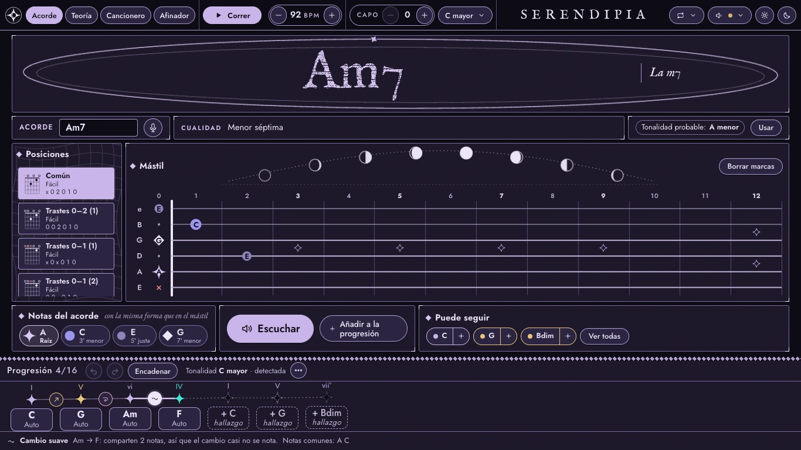
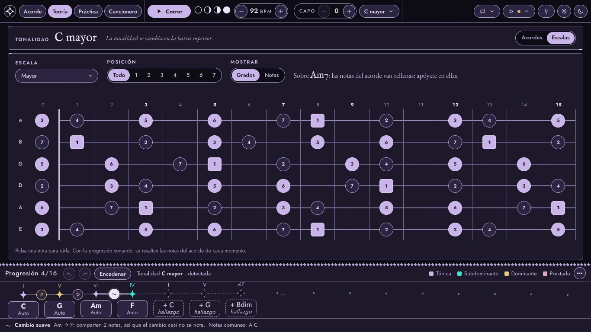
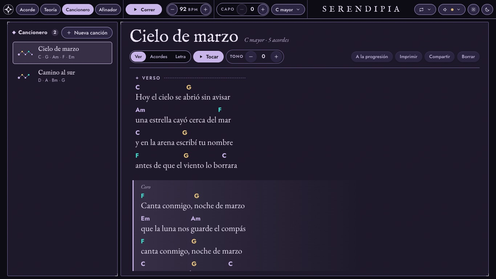
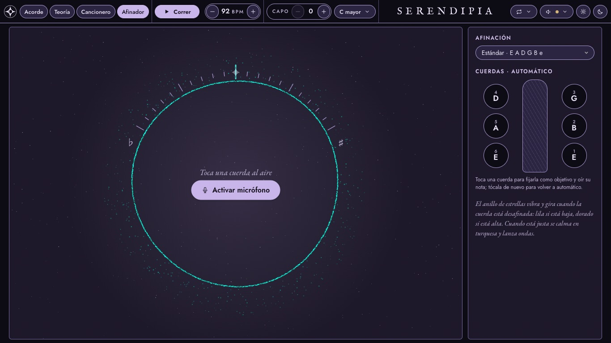
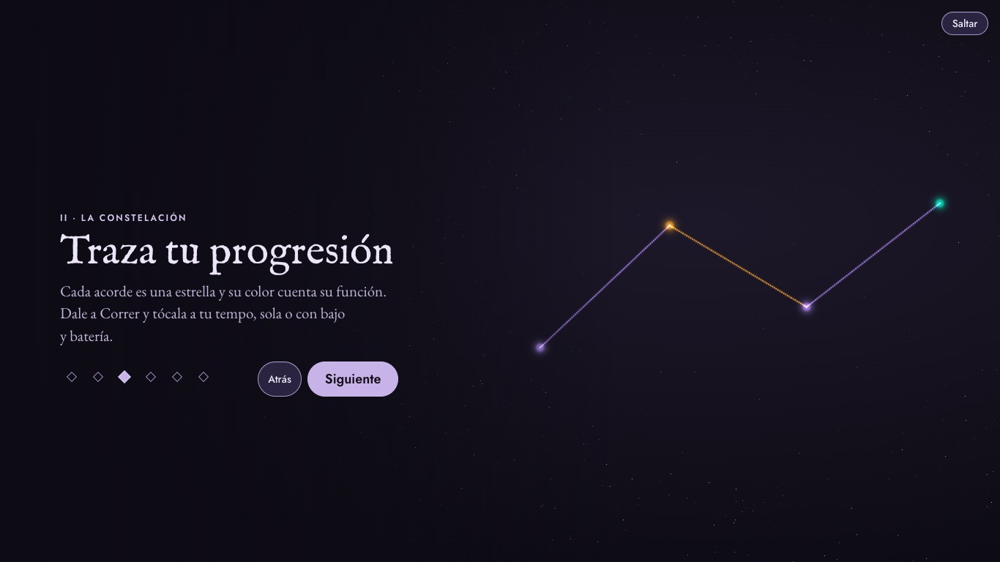
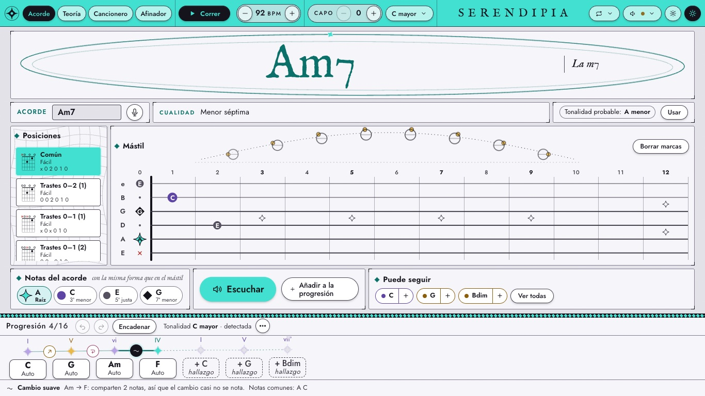
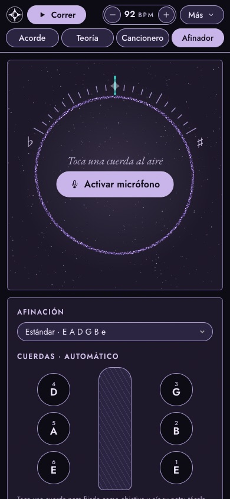

# SERENDIPIA

**Acordes, teoría, canciones y afinador para tocar guitarra** — en el navegador, sin cuentas y también sin conexión.

**▶ Pruébala: [juansit-0.github.io/SERENDIPIA](https://juansit-0.github.io/SERENDIPIA/)**



*Serendipia: hallazgo valioso que llega sin buscarlo.* La app es un mapa del cielo para encontrar acordes, encadenarlos y quedarte con los que suenan bien.

> **In English.** SERENDIPIA is a guitar practice web app: look up or detect any chord (by typing, marking the fretboard or playing it into the microphone), build progressions that play themselves over a bass-and-drums backing, see scales over the whole neck, keep a songbook with chords over the lyrics, and tune up in a sky of stars. React + TypeScript + Tone.js, no backend, installable and offline. Spanish and English UI.

## Qué hace

**Acorde** — Escribe un acorde (`Am7`, `Do`, `G/B`…), márcalo en el mástil o tócalo con el micrófono encendido: te dice su nombre, sus notas por función (raíz, tercera, séptima…) y todas las posiciones para tocarlo, de la más fácil a la más difícil. «Puede seguir» propone acordes que encajan.

**La progresión** — Tus acordes como una constelación: el color de cada estrella es su función armónica (tónica, subdominante, dominante, prestado) y entre cada par un comentario explica el cambio. Suena sola al tempo que elijas, con un rasgueo (o tu propio patrón) y, si quieres, con **bajo y batería** en estilo pop, balada, rock o bossa nova. Se transpone, se encadena para mover la mano lo mínimo, recomienda cejilla, se guarda, se comparte por enlace y se imprime con los diagramas.

**Teoría** — Los acordes de la tonalidad con su función, progresiones clásicas listas para usar y **escalas sobre todo el mástil** por posiciones, con las notas del acorde que suena resaltadas para improvisar.

| | |
|---|---|
|  |  |
| **Escalas** en Teoría | **Cancionero** |
|  | |
| **Afinador** | |

**Afinador** — Su propia pestaña: activa el micrófono y toca una cuerda al aire. Un anillo de estrellas (three.js) vibra y gira mientras está desafinada — lila si está baja, dorado si está alta — y se calma en turquesa, lanzando ondas, cuando está justa. Las clavijas de un clavijero fijan la cuerda y la hacen sonar.

**Cancionero** — La letra con los acordes encima de cada sílaba (formato ChordPro: `[C]Hoy el [G]cielo`). Al tocarla, el acorde que suena se ilumina y la letra avanza sola. Se transpone, se imprime y se comparte. Arriba, los diagramas de sus acordes; y el **modo escenario** la pone sola en pantalla completa, con letra grande que se desplaza sola o con el pedal, para leer desde el atril.

**Herramientas** — El cielo sobre el mástil (lunas de noche, soles de día) que sigue el pulso, metrónomo con subdivisión, marcar el tempo tocando (tecla `T`), control con pedal de pasar páginas, pantalla siempre encendida mientras practicas, tema de noche y de día (automático), notación C o Do, español e inglés. La ayuda está en la tecla `?`.

| | |
|---|---|
|  |  |
| La bienvenida (three.js) | El tema de día |

<p align="center"></p>

## Cómo está hecha

- **React 19 + TypeScript + Vite**, estilos con Tailwind CSS v4 y un sistema de diseño propio («Carta celeste», descrito en [`DESIGN.md`](DESIGN.md)).
- **Teoría musical en TypeScript puro** (`src/music/`): análisis de acordes y tonalidades, posiciones, detección de acordes desde trastes y desde audio (FFT, picos espectrales y descarte de armónicos), escalas, transposición, ChordPro. Sin IA y sin servidor.
- **Audio con Tone.js**: muestras de guitarra reales, rasgueos, metrónomo y una banda con batería y bajo grabados (bajo que camina hacia el siguiente acorde). Afinador y «Oír» con la Web Audio API.
- **three.js** solo para la bienvenida y el afinador, cargado bajo demanda.
- **Sin backend**: todo lo del usuario vive en su navegador (`localStorage` e IndexedDB para las grabaciones), con copia de seguridad descargable. Se instala como app (PWA: icono adaptable, accesos directos, botón «Instalar» en Ajustes y aviso de versión nueva) y funciona sin conexión gracias a un *service worker* generado al compilar.
- **Calidad**: más de 400 tests con Vitest y Testing Library, auditoría de accesibilidad automática con axe, lint con oxlint, y una prueba de humo contra la web publicada tras cada despliegue (GitHub Actions → GitHub Pages).

## Ejecutarla en local

```bash
npm install
npm run dev        # http://localhost:5173
npm test           # tests (Vitest)
npm run lint       # oxlint
npm run build      # compilación de producción
```

`npm run build:pages` compila para GitHub Pages (base `/SERENDIPIA/`); el despliegue es automático con cada push a `main`.

## Audio y licencias

Las muestras de guitarra de `src/assets/samples/` salen de los soundfonts MusyngKite publicados por [gleitz/midi-js-soundfonts](https://github.com/gleitz/midi-js-soundfonts), con licencia **CC BY-SA 3.0**; se regeneran con `npm run samples` (requiere `ffmpeg`). El bajo sale de los mismos soundfonts y la batería de [Big Rusty Drums](https://github.com/sfzinstruments/karoryfer.big-rusty-drums) de Karoryfer, con licencia **CC0**; ambos se regeneran con `node scripts/fetch-band.mjs`. Tipografías IM Fell English, EB Garamond y Jost (SIL OFL).

El código se publica con [licencia MIT](LICENSE). Hecha por Juan Camilo López Díaz.
